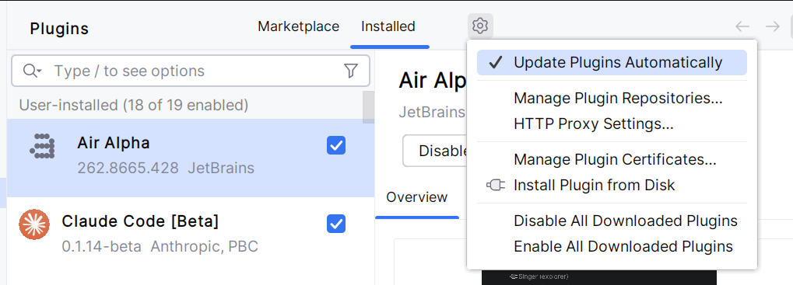

# Herdr for IntelliJ

An IntelliJ Platform plugin that runs [herdr](https://herdr.dev) in its own tool window, separate from the built-in
Terminal tool window, so it can be viewed alongside a regular shell or detached into its own floating window.

Works in any IntelliJ Platform IDE (IntelliJ IDEA, PyCharm, WebStorm, GoLand, RubyMine, CLion, Rider, etc.); only
tested against PhpStorm so far.

## Releases / Installation

Download the plugin ZIP from [Releases](https://git.1xinternet.de/f.lassen/intellij-herdr-plugin/-/releases).

Go to File > Settings > Plugins, click the Cogwheel, then "Install Plugin from Disk...", select the ZIP and restart
the IDE.



You'll need [herdr](https://herdr.dev) installed.

After restart you'll have a tool in the sidebar. Default action toggle is `Control + Alt + h`.

## Features

- **Dedicated tool window** — herdr runs in its own "Herdr" tool window (bottom, next to Terminal by default),
  keeping it independent from your regular shell sessions.
- **Session switching** — attach the tool window to any herdr session for the current project via the title-bar
  action, and the choice is remembered per-project.
- **Suspend / reawake** — the pause button in the title bar stops the project's herdr session after asking first,
  freeing the CPU and memory its agents and shells use. herdr keeps the workspaces, tabs, splits, working
  directories and agent conversations, so "Reawake session" brings everything back where you left off and resumes
  the agents. The project stays suspended across IDE restarts until you reawake it. Scrollback and other running
  processes (dev servers, watchers) are not restored.
- **Agents overview** — a second tab lists every herdr agent across all running sessions, sorted by what needs
  attention first (blocked > done > working > idle), with desktop notifications when an agent's status changes to
  blocked or done. Double-click an agent to jump straight to its pane.
- **Auto-detected binary** — the plugin locates the `herdr` binary automatically; if it can't be found, set an
  explicit path under **Settings → Tools → Herdr**.
- **Quick open** — `Ctrl+Alt+H` opens (or focuses) the Herdr tool window from anywhere.

## Requirements

- An IntelliJ Platform IDE, 2026.2+ (developed/tested against PhpStorm; should work on IntelliJ IDEA, PyCharm,
  WebStorm, GoLand, RubyMine, CLion, Rider, etc.)
- The [herdr](https://herdr.dev) CLI installed and available on your `PATH` (or configured explicitly in settings)

## Development

This project uses the [IntelliJ Platform Gradle Plugin](https://plugins.jetbrains.com/docs/intellij/tools-intellij-platform-gradle-plugin.html)
and a [Taskfile](https://taskfile.dev) for common commands:

```bash
task compile   # quick compile check, no packaging
task run       # launch a sandboxed IDE with the plugin installed
task build     # build the installable plugin zip
task release   # bump the version and build the zip (LEVEL=patch|minor|major)
```

Run `task --list-all` for the full list of available tasks.
